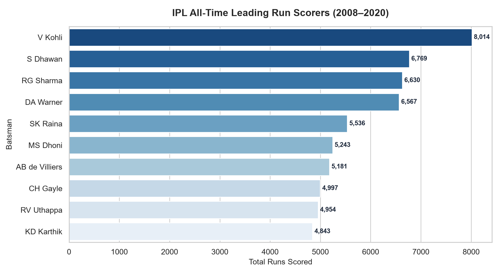
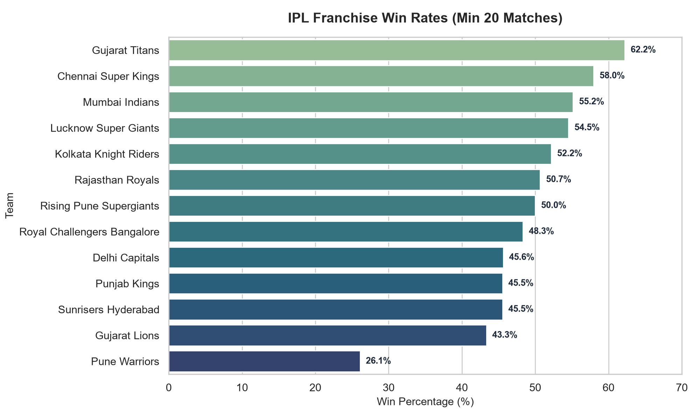
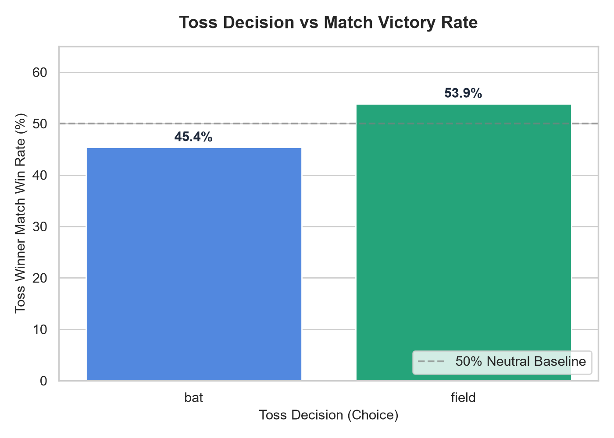
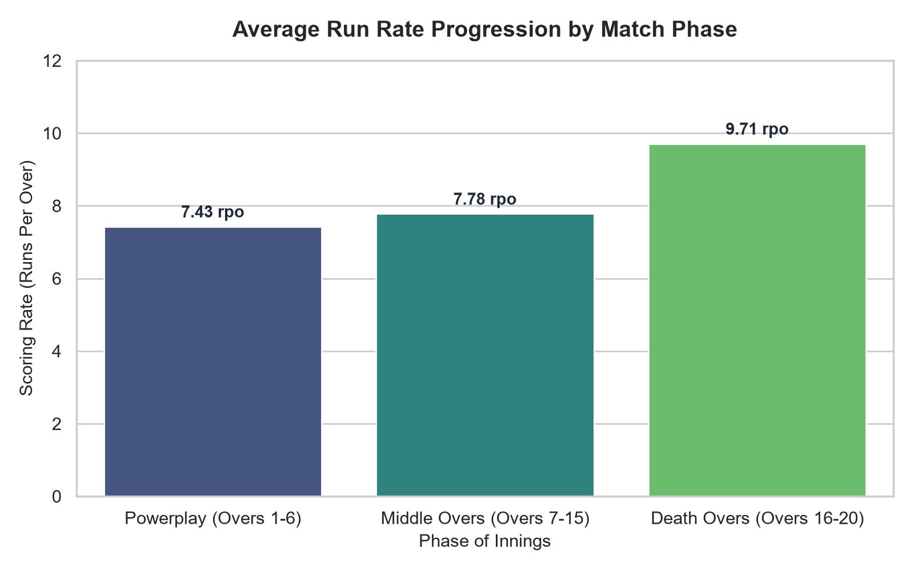

# IPL Cricket Data Analysis Pipeline

A comprehensive SQL-based analysis of Indian Premier League (IPL) cricket data spanning 2008-2020, using Python, SQLite, and data visualization libraries.

## Overview

This project demonstrates end-to-end data analysis capabilities:
- Loading and cleaning raw CSV data into a relational SQLite database
- Writing 15+ analytical SQL queries including JOINs, aggregations, and window functions
- Generating insightful visualizations for team performance, player statistics, and venue analysis

## Tech Stack

- **Python 3.8+**
- **SQLite** (via `sqlite3` standard library)
- **Pandas** for data manipulation
- **Matplotlib & Seaborn** for visualization
- **Jupyter Notebook** for interactive analysis

## Project Structure

```
ipl-cricket-sql-analysis/
├── data/
│   ├── matches.csv          # Match-level data (1,000+ matches)
│   └── deliveries.csv       # Ball-by-ball delivery data (200,000+ records)
├── notebooks/
│   └── ipl_analysis.ipynb   # Main analysis notebook
├── src/
│   ├── load_data.py         # Data loading and SQLite database creation
│   └── queries.py           # All SQL queries as named functions
├── outputs/
│   └── charts/              # Generated visualization images
├── requirements.txt
└── README.md
```

## Key Analyses

1. **Team Performance:** Win rates by team, home vs away performance, toss decision impact
2. **Player Impact:** Top run scorers, highest strike rates in powerplay, best bowling figures
3. **Venue Statistics:** Average first innings scores, chasing success rates, boundary percentages
4. **Seasonal Trends:** Performance evolution across 13 IPL seasons (2008-2020)
5. **Match Dynamics:** Win margin distributions, super over analysis, impact of winning toss

## Sample Insights

- Teams winning the toss and choosing to field first win **~52%** of the time
- The top 5 venues for chasing teams show a **>55%** chase success rate
- Powerplay run rates have increased by **~18%** from 2008 to 2020

## Visual Analytics & Generated Reports

### 1. All-Time Leading Run Scorers (2008–2020)


### 2. Franchise Win Percentages Across All Seasons


### 3. Impact of Toss Decision on Match Outcomes


### 4. Over-by-Over Phase Run Rate Dynamics


## Setup & Usage

```bash
# Install dependencies
pip install -r requirements.txt

# Load data into SQLite database
python src/load_data.py

# Open the analysis notebook
jupyter notebook notebooks/ipl_analysis.ipynb
```

## SQL Techniques Used

- Multi-table `JOIN` operations (INNER, LEFT)
- `GROUP BY` with `HAVING` clauses
- Window functions: `RANK()`, `ROW_NUMBER()`, `LAG()`
- Subqueries and Common Table Expressions (CTEs)
- Aggregate functions: `COUNT`, `SUM`, `AVG`, `MAX`
- `CASE WHEN` conditional logic

## Dataset

The IPL dataset is publicly available on [Kaggle](https://www.kaggle.com/datasets/patrickb1912/ipl-complete-dataset-20082020) and contains:
- **matches.csv**: 930+ matches with team names, venue, toss details, result, and umpire info
- **deliveries.csv**: 200,000+ ball-by-ball records with batting, bowling, runs, wickets, and extras

## License

This project is for educational and portfolio purposes. The IPL dataset is publicly available under open data licenses.
